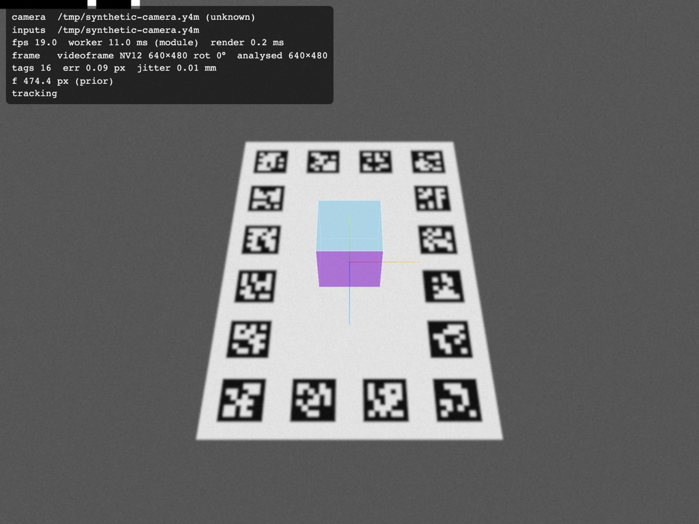
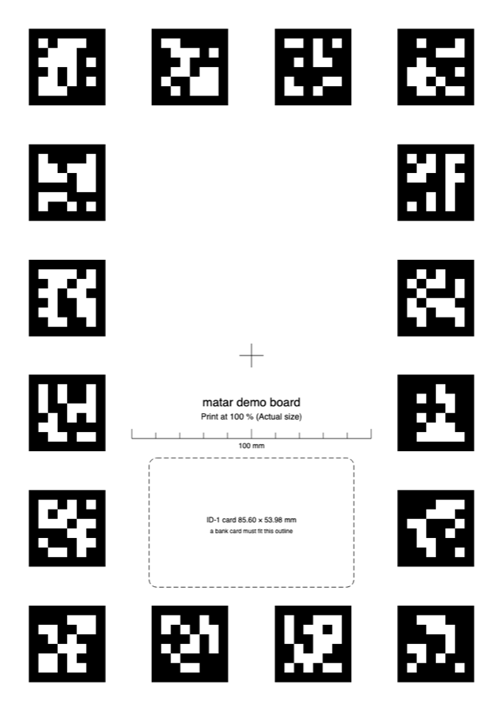

# matar

**Browser AR for printed paper mats.** Print a sheet of square tags, point a phone at it,
and three.js content stays put on the paper, in iPhone Safari and Android Chrome alike.
No WebXR, no app, no server.

[](CHANGELOG.md)
[](LICENSE)
[](package.json)
[](.size-limit.json)
[](docs/DEVICE-TESTS.md)

[Spec](docs/SPEC.md) · [Architecture](docs/ARCHITECTURE.md) · [Demo](#demo) ·
[Device tests](docs/DEVICE-TESTS.md) · [Changelog](CHANGELOG.md)

<p>
  <a href="docs/images/demo-tracking-synthetic.jpg"></a>
  <a href="docs/images/demo-board-a4.png"></a>
</p>

_Left: the demo in desktop Chromium, tracking a **synthetic** camera video rendered by the
test suite (the same input the end-to-end test uses), with a 50 mm cube on the board origin.
Right: the board the demo prints, A4 at 100 %. Photos from real phones will follow the
device tests._

## Why

WebXR's AR features don't exist in iOS Safari, so web AR on iPhone usually means an app
or an App Clip. matar does the tracking itself with standard web APIs, for the case where
you control what's printed: a mat, a poster, a game board, a museum label.

- **Works on iPhone and Android without WebXR.** Only `getUserMedia`, a Web Worker and
  WebGL: designed for iOS Safari 17+ and current Android Chrome.
- **Predictable, tiny download; nothing uploaded.** ≈ 34 KB min+gzip including the worker,
  zero runtime dependencies, no network requests of its own. Camera frames never leave
  the phone (the e2e test fails on any foreign request or request body).
- **Accurate.** AprilTag tag36h11 detection with sub-pixel, gamma-aware edge refinement
  (0.01 px corner RMS on clean synthetic frames), then IPPE + Levenberg–Marquardt over all
  visible tags. End to end through Chromium's camera pipeline: within 0.5 mm / 0.07° of the
  ground truth.
- **No swimming.** The video behind the scene is the exact frame the pose was computed
  from, so content stays glued to the paper while the phone moves.
- **Calibrates itself.** Browsers don't expose focal length; matar estimates it from the
  board as the phone moves (≤ 0.3 % after 20 views). Save it per device and pass it back.
- **Robust.** One visible tag is enough; misprinted, foreign or misdecoded tags are rejected
  by a consensus step; a One Euro filter smooths with little lag (≈ 11 ms at 100 mm/s).
- **Printable boards.** A layout helper and SVG output in exact millimetres, with a ruler and
  a bank-card outline so users can check they printed at 100 %.

## Installation

Requirements: an ESM bundler that understands `new Worker(new URL(…, import.meta.url))`.
Checked with Next.js 16 (Turbopack and webpack), Vite 8. `three ≥ 0.173` if you use
`matar/three`.

matar isn't on npm yet. Build the tarball and install it in your app:

```bash
git clone <this repo> matar && cd matar && pnpm install && pnpm build && pnpm pack
cd ../your-app && pnpm add ../matar/matar-0.1.0.tgz three
```

## Usage

```ts
import { boardSvg, createBoard, createTracker, layoutBorderTags, pickTagIds } from 'matar';
import { MatarThree } from 'matar/three';
import * as THREE from 'three';

// 1. A board: 16 tags of 32 mm around an A4 page, origin at the page centre.
const page = { x: 0, y: 0, width: 210, height: 297 };
const origin: [number, number] = [105, 148.5];
const ids = pickTagIds('tag36h11', 16, 'my-board'); // seed it per board
const board = createBoard({
  tags: layoutBorderTags({ areaMm: page, originMm: origin, sizeMm: 32, ids }),
});
const svg = boardSvg(board, { pageMm: [210, 297], originMm: origin }); // print at 100 %

// 2. Track it and draw in board coordinates (metres, Y up, origin on the paper).
const tracker = createTracker({ board });
const renderer = new THREE.WebGLRenderer();
renderer.setSize(innerWidth, innerHeight);
document.body.append(renderer.domElement);
const scene = new THREE.Scene();
const camera = new THREE.PerspectiveCamera();
const ar = new MatarThree({ tracker, renderer, scene, camera });

const cube = new THREE.Mesh(
  new THREE.BoxGeometry(0.05, 0.05, 0.05),
  new THREE.MeshNormalMaterial(),
);
cube.position.y = 0.025;
scene.add(cube);

const start = document.querySelector('button')!;
start.onclick = () => tracker.start(); // asks for the camera: call it from a tap
renderer.setAnimationLoop(() => {
  cube.visible = ar.update().tracking;
  renderer.render(scene, camera);
});
```

1. Print the SVG at 100 % ("Actual size") and check the 100 mm ruler. If it's off, scale
   the board with `scaleBoard(board, measuredMm / 100)`.
2. Serve your page over HTTPS (the camera needs a secure context).
3. Open it on the phone, tap Start, allow the camera, point it at the paper.

To skip focal-length calibration on later visits, save `tracker.intrinsics` from the
`'intrinsics'` event and pass it back as `createTracker({ board, intrinsics })`. Raw and
smoothed poses, detections and timings arrive in `'pose'` events. The full API is in
[ARCHITECTURE.md §8](docs/ARCHITECTURE.md#8-public-api-normative), and the known
limitations are in [SPEC.md §7](docs/SPEC.md#7-known-limitations-documented-to-users).

## Demo

```bash
pnpm install
pnpm dev     # HTTPS on your LAN (self-signed): open the printed URL on a phone
```

The demo prints its board (**Print board**), tracks it with a cube on the origin, and shows
a debug HUD (camera, fps, timings, reprojection error, jitter, focal length).
After Start, **Mode** switches between the analysed frame behind the content (`frame`)
and the newest camera frame with an extrapolated pose (`live`), and **Copy report**
copies the last 5 s of timings for a device-test note. `?inline` runs without a worker,
`?debug` adds a thumbnail of the analysed frame, `?bg=video` uploads the `<video>`
instead of the `VideoFrame`.

## Status

All maths and vision stages are covered by synthetic tests with explicit tolerances
([TASKS.md](docs/TASKS.md)), and the whole pipeline runs end to end in Chromium with a fake
camera. **It has not yet been tested on real phones**: iPhone Safari and Android Chrome
behaviour (lens switching, frame formats, timings) is checked by hand with
[DEVICE-TESTS.md](docs/DEVICE-TESTS.md), and the results will be recorded there.

## Development

```bash
pnpm test          # unit + synthetic tests (vitest)
pnpm test:e2e      # Playwright: the demo with a fake camera, WebGL texture readback
pnpm lint && pnpm typecheck
pnpm build         # tsc → dist/
pnpm size          # bundle-size budgets
pnpm smoke         # the packed tarball in Next.js and Vite apps, with the fake camera
pnpm bench         # per-stage timings
```

Contributors (human or AI) start with [CLAUDE.md](CLAUDE.md) and the docs it links.

## Licence

[Apache-2.0](LICENSE), see [NOTICE](NOTICE). Includes the AprilTag tag36h11 code table
(BSD-2-Clause, University of Michigan); see [THIRD_PARTY_NOTICES](THIRD_PARTY_NOTICES).
